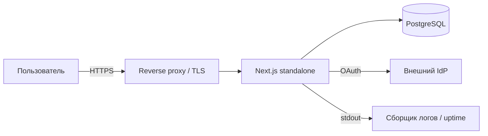
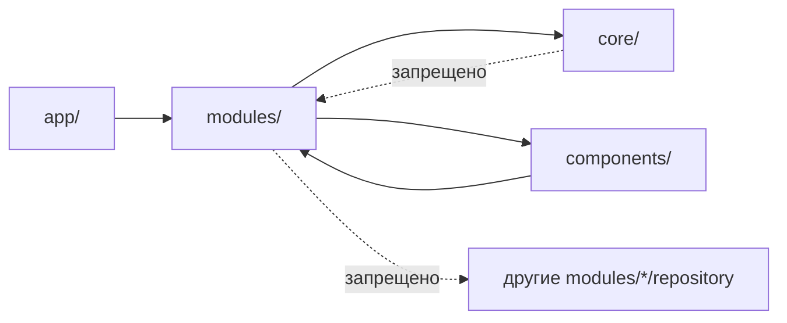
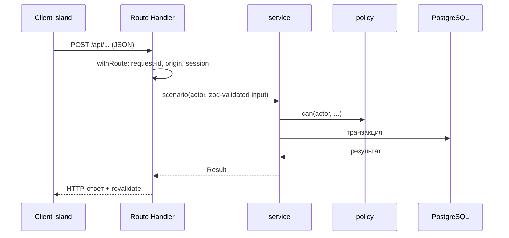
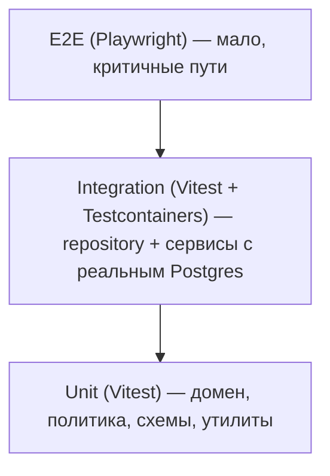
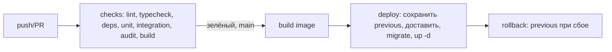

---

# `GUIDE.md`

```markdown
# Инженерный гайд проекта

Набор обязательных соглашений для нового проекта на Next.js (App Router).
Стек и решения выбраны с учётом ограничений малого хостинга и небольшой команды.

## Железные правила (TL;DR)

- Чтение данных — на сервере (RSC), мутации — через Route Handlers.
- `app → modules → core`; обратных зависимостей нет.
- Никакого прямого SQL вне `modules/*/repository.ts`.
- Все границы входа валидируются zod-схемой из `modules/*/schema.ts`.
- Права проверяются через `core/auth/policy.ts::can(...)`, а не в компонентах.
- Схема БД меняется только миграцией, не правкой `schema.sql`.
- Секреты и env валидируются на старте и роняют приложение при ошибке.
- Клиентские компоненты — только «острова» интерактива; данные в них не грузятся `fetch` при монтировании.
```

---

```markdown
# Обзор: принципы, стек, границы

## Назначение

Документ задаёт фундамент: что за приложение, на чём строим и какие принципы нельзя нарушать.

## Профиль проекта (зафиксировано)

| Параметр | Значение |
| --- | --- |
| Продукт | Movie Tracker (рабочее название; уточнить бренд) |
| Домен | учёт просмотренных фильмов: индивидуально и в группах |
| Роли | `user`, `admin` |
| Ключевые сценарии | 1) отметить фильм просмотренным; 2) создать/вступить в группу и вести общую статистику; 3) смотреть личную и групповую статистику параллельно; 4) админ управляет справочником фильмов и пользователями; 5) вход через Google (или demo-вход) |
| OAuth-провайдер | Google (Auth.js), demo-вход `DEMO_LOGIN` для course-окружения |
| Регистрация | одноразовый HMAC-ticket (`/api/auth/register`) + сессия + совпадающий email |
| Границы системы | Приложение + PostgreSQL + Google IdP; внешние системы — за границей |
| Целевой хостинг | 1 контейнер приложения + 1 БД, self-hosted или managed |

> Профиль используется будущими доменными изменениями (фильмы, группы, статистика).
> Сам bootstrap доменных требований не вводит.

## Стек (зафиксированные версии)

Версии зафиксированы точно (без `^`/`~`) в `package.json`.

| Слой | Выбор | Версия | Почему |
| --- | --- | --- | --- |
| Runtime | Node.js | >= 20.9 (24.x) | Требование Next 16 |
| Framework | Next.js (App Router, Turbopack, `output: 'standalone'`) | 16.3.8 | RSC + один процесс, экономия памяти |
| Язык | TypeScript strict | 5.5.4 | Контракты и рефакторинг |
| UI | React / React DOM | 19.3.0 | Требование Next 16 |
| UI | Tailwind CSS | 4.3.3 | Токены, CSS-first конфигурация |
| UI | shadcn/ui (Radix), `@radix-ui/react-slot` | 1.3.3 | Скорость, доступность, токены |
| БД | PostgreSQL | 16 (`postgres:16-alpine`) | Надёжность, транзакции |
| Доступ к БД | `pg` (без ORM) | 8.23.1 | Малый хостинг, прозрачный SQL |
| Миграции | `node-pg-migrate` | 7.6.1 | Версионирование схемы |
| Валидация | `zod` | 3.25.76 | Единые схемы клиент/сервер/env |
| Аутентификация | Auth.js / NextAuth | 5.0.0-beta.32 | OAuth-поток для Next 16 / React 19 |
| Тесты | Vitest | 5.0.3 | Unit/component |
| Тесты | Testing Library (`@testing-library/react`) | 16.3.3 | Компонентные тесты |
| Тесты | Testcontainers | 12.2.0 | Изоляция интеграции |
| Тесты | Playwright | 1.63.0 | E2E |
| Сборка/линт | eslint / eslint-config-next | 9.39.5 / 16.3.8 | Flat config |
| Границы | dependency-cruiser | 16.10.4 | Enforce зависимостей |
| Наблюдаемость | Структурные JSON-логи + request-id + health | — | Минимум без внешних затрат |

> **Почему Next 16 / React 19.** У Next.js < 16.3.8 нет пропатченных релизов (critical-апдейты RCE/DoS/SSRF), поэтому блокирующий `npm audit` не проходил на Next 14. Стек поднят до Next 16 + React 19 и Auth.js v5. Гейт `npm run audit` проверяет только production-дерево (`npm audit --omit=dev --audit-level=high`) — оно даёт 0 уязвимостей; оставшиеся advisories находятся исключительно в dev-toolchain (например, `braces` через `eslint-config-next`, апстрим-фикса пока нет) и отслеживаются отдельно.

## Принципы (нарушение = стоп)

1. **Server-first.** Данные для отображения читаются серверными компонентами.
2. **Явные границы.** Модуль = bounded context; чужие репозитории недоступны.
3. **Единый источник правил.** Домен и валидация — в одном месте, не дублируются в UI.
4. **Fail-fast конфигурация.** Ошибка env обнаруживается при старте, а не в проде.
5. **Безопасность по умолчанию.** Права на сервере; клиент — только UX.
6. **Версионируемая схема.** Только миграции; `schema.sql` как «migration 0».
7. **Управляемая связанность.** Правила зависимостей проверяются автоматически в CI.
8. **Наблюдаемость встроена.** Каждый запрос трассируется request-id, каждый сбой логируется.

## Что сознательно НЕ берём

- Микросервисы, message broker, Kubernetes — избыточно для малой команды.
- Тяжёлый ORM с кодогенерацией и state-менеджер (Redux/Zustand) — заменяются RSC.
- Внешнюю систему логов/трейсинга на старте — сначала stdout + сборщик хоста.

## Диаграмма верхнего уровня


```

---

# `docs/01-structure.md`

```markdown
# 01. Структура проекта

## Дерево каталогов (эталон)

```
project/
├── src/
│   ├── app/                          # только маршрутизация и композиция
│   │   ├── layout.tsx                # корневой layout (шрифт, метрика, провайдеры)
│   │   ├── globals.css
│   │   ├── (auth)/
│   │   │   ├── login/page.tsx        # RSC-обёртка + client-форма
│   │   │   └── register/page.tsx
│   │   ├── (app)/
│   │   │   ├── layout.tsx            # requireSession() → redirect
│   │   │   ├── page.tsx              # RSC: читает через service
│   │   │   ├── calendar/page.tsx
│   │   │   ├── faq/page.tsx
│   │   │   ├── admin/page.tsx
│   │   │   ├── loading.tsx
│   │   │   └── error.tsx
│   │   └── api/                      # ТОЛЬКО мутации + health
│   │       ├── auth/[...nextauth]/route.ts
│   │       ├── auth/register/route.ts
│   │       └── health/route.ts
│   ├── modules/                      # bounded contexts
│   │   ├── auth/       { options.ts, session.ts, service.ts, policy.ts, ticket.ts, repository.ts, schema.ts, types.ts }
│   │   ├── directory/  { service.ts, repository.ts, schema.ts, types.ts }
│   │   └── support/    { service.ts, repository.ts, policy.ts, schema.ts, types.ts }
│   ├── core/
│   │   ├── db/         { pool.ts, transaction.ts, migrations/, migrate.ts }
│   │   ├── config/     { env.ts, secrets.ts }
│   │   ├── log/        { logger.ts, request-id.ts }
│   │   ├── http/       { responses.ts, origin.ts, with-route.ts }
│   │   ├── auth/       { policy.ts }                    # can(actor, action, resource)
│   │   └── result.ts
│   ├── components/
│   │   ├── ui/         # shadcn-обёртки, без бизнес-логики
│   │   ├── layout/     # Header, Footer, ThemeSwitcher, Banners
│   │   └── features/   # бизнес-компоненты по фичам
│   └── types/
├── tests/
│   ├── unit/
│   ├── integration/    # repository против testcontainers
│   └── e2e/            # Playwright
├── db/seed/            # только демо-данные; схема — в миграциях
├── docs/               # этот гайд
├── public/
├── .github/workflows/ci-cd.yml
├── Dockerfile
├── docker-compose.yml
├── .env.example
├── next.config.js
├── tailwind.config.ts
├── tsconfig.json
├── vitest.config.ts
├── playwright.config.ts
└── package.json
```

## Правила именования

| Объект | Соглашение | Пример |
| --- | --- | --- |
| Модуль домена | существительное, мн./ед. по смыслу | `donations`, `support` |
| Сервис | `<модуль>/service.ts`, экспорт `verbXxx` | `contribute()`, `listThreadsFor()` |
| Репозиторий | `<модуль>/repository.ts`, экспорт `find*/list*/insert*/update*` | `findUserByEmail()` |
| Политика | `<модуль>/policy.ts` | `canContribute(actor, recipient)` |
| Схема | `<модуль>/schema.ts`, zod | `contributeInput` |
| RSC-страница | `page.tsx` | — |
| Клиентский компонент | `PascalCase.tsx` + `'use client'` | `DonateDialog.tsx` |
| Хук | `useXxx.ts` | `useAsyncAction.ts` |
| Миграция | `NNN_описание.sql` | `003_add_contribution_ledger.sql` |

## Правила зависимостей (enforce в CI)



- `core/` **не импортирует** `modules/` и `components/`.
- `modules/X` не импортирует `modules/Y/repository.ts`; разрешён только `modules/Y/service.ts`.
- `components/ui/` не импортирует ничего из `modules/`.
- Проверка: `dependency-cruiser` + скрипт `npm run deps:check` в CI.
## Конфигурация пути

`tsconfig.json`:

```jsonc
{
  "compilerOptions": {
    "strict": true,
    "noUncheckedIndexedAccess": true,
    "moduleResolution": "bundler",
    "paths": { "@/*": ["./src/*"] }
  }
}
```

## Правила размещения файлов

1. Новая предметная область → новый каталог в `src/modules/`.
2. Новая страница → `src/app/...` (RSC), интерактив выносится в `components/features/`.
3. Новая таблица/агрегат → миграция + репозиторий в соответствующем модуле.
4. Утилиты без домена → `core/`; утилиты отображения → `components/`.
5. Один публичный экспорт на файл-сервис допустим, но файл не смешивает сценарии разных агрегатов.
```
---

# `docs/02-architecture.md`

```markdown
# 02. Архитектура: слои, границы, потоки

## Слои

```
Presentation (app/, components/)
        │ вызов (RSC) / HTTP (мутации)
Application (modules/*/service.ts)   ← сценарии, оркестрация, транзакции
        │
Domain (modules/*/domain.ts, policy.ts, schema.ts)   ← чистые правила и валидация
        │
Data access (modules/*/repository.ts)
        │
Infrastructure (core/db, core/config, core/log, core/http)
        │
PostgreSQL / внешние системы
```
## Ответственность слоёв

| Слой | Отвечает | НЕ отвечает |
| --- | --- | --- |
| `app/` | маршрутизация, авторизация маршрута, композиция RSC | бизнес-логика, SQL |
| `components/` | отображение и интерактив | доступ к БД, права |
| `modules/*/service.ts` | сценарий, транзакция, вызов политики и репозитория | HTTP-детали |
| `modules/*/domain.ts` | чистые функции правил | I/O |
| `modules/*/policy.ts` | правила допуска | запросы к БД |
| `modules/*/repository.ts` | SQL, маппинг строк | решения о правах |
| `core/*` | инфраструктура | знание о домене |

## Шаблон модуля

```
modules/donations/
├── types.ts        # доменные типы модуля
├── schema.ts       # zod-схемы входа/выхода (общие для клиента и сервера)
├── domain.ts       # чистые правила (лимиты, eligibility)
├── policy.ts       # can...(actor, resource)
├── repository.ts   # SQL + маппинг
├── service.ts      # сценарии, транзакции
└── index.ts        # публичный API модуля (только то, что можно наружу)
```
Пример `service.ts`:

```ts
// modules/donations/service.ts
import { withTransaction } from '@/core/db/transaction';
import { canContribute } from './policy';
import { insertContribution, upsertCollection } from './repository';
import type { Actor } from '@/modules/auth/types';
import type { ContributeInput } from './schema';

export async function contribute(actor: Actor, input: ContributeInput) {
  const recipient = await mustFindRecipient(input.recipientId); // из directory/service
  const decision = canContribute(actor, recipient);
  if (!decision.ok) return decision; // типизированный отказ, не throw

  return withTransaction(async (tx) => {
    const contribution = await insertContribution(tx, { ...input, donorId: actor.id });
    const collection = await upsertCollection(tx, input.recipientId, input.amount);
    return { ok: true as const, contribution, collection };
  });
}
```

## Модель результата (без «магии» исключений)

```ts
// core/result.ts
export type Ok<T> = { ok: true; value: T };
export type Err = { ok: false; code: ErrCode; message: string };
export type Result<T> = Ok<T> | Err;

export const ok = <T>(value: T): Ok<T> => ({ ok: true, value });
export const err = (code: ErrCode, message: string): Err => ({ ok: false, code, message });
```

Правила:
- Ожидаемые отказы (валидация, права, бизнес-правила) → `Result`, не исключения.
- Непредвиденные сбои (БД недоступна) → исключение → `withRoute` логирует и отвечает 500.

## Когда RSC, когда Route Handler

| Операция | Механизм |
| --- | --- |
| Чтение данных для страницы | RSC → `service.ts` напрямую |
| Форма/мутация | Client island → `fetch('/api/...')` → Route Handler → `service.ts` |
| Health/readiness | Route Handler |
| OAuth callback | Route Handler (framework) |
| Server Action | Допустимо для форм, если нет нужды в отдельном API; правила те же |

## Типичный поток чтения

```mermaid
sequenceDiagram
  participant U as Пользователь
  participant RSC as Server Component
  participant S as modules/*/service
  participant DB as PostgreSQL
  U->>RSC: GET /route
  RSC->>S: readScenario(actor, params)
  S->>DB: агрегированный SELECT
  DB-->>S: rows
  S-->>RSC: view-model
  RSC-->>U: HTML с данными
```



## Типичный поток мутации



## Правила модуля

1. Наружу экспортируется только `index.ts` (сервис + типы + схемы).
2. Репозиторий виден только своему сервису.
3. Политика не делает запросов; ресурсы передаются ей готовыми.
4. Транзакции открывает сервис, не репозиторий.
5. Один сценарий — один публичный метод сервиса.
```
---

# `docs/03-data.md`

```markdown
# 03. Данные: БД, миграции, сервисы, репозитории

## Принципы

1. Схема меняется **только** миграцией.
2. Доступ к БД — только через `repository.ts` своего модуля.
3. Сервис владеет транзакцией; репозиторий принимает `client|tx`.
4. Только параметризованный SQL; динамика — лишь статические константы модуля.
5. Денежные суммы — целые (минорные единицы) с `CHECK >= 0`; агрегаты вычисляются, а не хранятся «на веру».

## Миграции

Инструмент: `node-pg-migrate` (или `umzug`).

```
src/core/db/migrations/
├── 1710000000000_init.sql
├── 1710000000001_seed-reference.sql
└── 1710000000002_add-contribution-ledger.sql
```
Команды:

```jsonc
// package.json
{
  "scripts": {
    "db:migrate": "node-pg-migrate up",
    "db:rollback": "node-pg-migrate down",
    "db:new": "node-pg-migrate create"
  }
}
```

Правила миграций:
- Идемпотентность (`IF NOT EXISTS`) там, где возможно.
- Обратимость: у каждой `up` есть разумная `down`.
- Данные отделены от схемы (`db/seed/` только для демо).
- Ни при каких условиях не править уже применённую миграцию — только новая.

## Модель денег (ledger)

Правильно для аудита и платежей:

```sql
-- contribution: каждая транзакция
CREATE TABLE contribution (
  id           uuid PRIMARY KEY DEFAULT gen_random_uuid(),
  donor_id     uuid NOT NULL REFERENCES users(id),
  recipient_id uuid NOT NULL REFERENCES users(id),
  amount       integer NOT NULL CHECK (amount > 0),
  status       text NOT NULL DEFAULT 'confirmed'
               CHECK (status IN ('pending','confirmed','refunded')),
  created_at   timestamptz NOT NULL DEFAULT now()
);
CREATE INDEX contribution_recipient_idx ON contribution (recipient_id, created_at DESC);

-- collection: проекция суммы (обновляется в той же транзакции)
CREATE TABLE collection (
  recipient_id uuid PRIMARY KEY REFERENCES users(id),
  total_amount integer NOT NULL DEFAULT 0 CHECK (total_amount >= 0),
  gift_sent    boolean NOT NULL DEFAULT false
);
```

Почему так:
- Можно вернуть конкретный взнос и построить аудит.
- Платёжный провайдер подключается без смены модели.
- `collection` — кэш для быстрых чтений, обновляется транзакционно.

## Паттерн репозитория

```ts
// modules/donations/repository.ts
import type { PoolClient } from 'pg';
import { query } from '@/core/db/pool';

export async function insertContribution(tx: PoolClient, input: {
  donorId: string; recipientId: string; amount: number;
}) {
  const { rows } = await tx.query(
    `INSERT INTO contribution (donor_id, recipient_id, amount, status)
     VALUES ($1, $2, $3, 'confirmed')
     RETURNING id, donor_id, recipient_id, amount, status, created_at`,
    [input.donorId, input.recipientId, input.amount]
  );
  return mapContribution(rows[0]);
}

export async function sumCollection(recipientId: string) {
  const rows = await query<{ total: string }>(
    `SELECT COALESCE(SUM(amount), 0)::text AS total
       FROM contribution WHERE recipient_id = $1 AND status = 'confirmed'`,
    [recipientId]
  );
  return Number(rows[0].total);
}
```

Правила репозитория:
- Экспорт только функций; никакого доменного решения внутри.
- Маппинг `snake_case → camelCase` локально (`mapX`).
- Именованные колонки в `RETURNING`, без `SELECT *`.
- Явные индексы под каждый реальный запрос списка.

## Паттерн сервиса

```ts
// modules/wishes/service.ts
import { canEditWish } from './policy';
import { insertWish, listBoardWishes } from './repository';
import type { WishInput } from './schema';

export async function createWish(actor: Actor, input: WishInput) {
  if (!canEditWish(actor, { authorId: actor.id })) return err('FORBIDDEN', 'Нет прав');
  return ok(await insertWish({ authorId: actor.id, ...input }));
}

export async function getBoard(actor: Actor, date: Date) {
  return listBoardWishes(date, actor.id);
}
```

## Границы и пагинация

- Каждый `list*` принимает `{ limit, cursor }` и возвращает `{ items, nextCursor }`.
- Жёсткий максимум `limit` в схеме (например, 100).
- Списки в UI не тянут «всё» — это скрытый источник деградации.

## Обязательные индексы (проверять на каждом PR со схемой)

| Запрос | Индекс |
| --- | --- |
| Пожелания по получателю | `wishes(target_user_id, created_at DESC)` |
| Сообщения ветки | `chat_messages(thread_user_id, created_at)` |
| Взносы получателя | `contribution(recipient_id, created_at DESC)` |
| Пользователь по email/sub | `users(email)`, `users(google_sub)` (уникальные) |
```
---

# `docs/04-auth-security.md`

```markdown
# 04. Аутентификация, права и безопасность

## Модель аутентификации

- OAuth через внешний IdP (Auth.js/NextAuth). Email считается подтверждённым только если провайдер это гарантирует.
- Идентичность привязывается к стабильному `subject` провайдера, не только к email.
- Сессия — `HttpOnly` + `Secure` + `SameSite=Lax`, ограниченный TTL.
- Регистрация новых пользователей — через одноразовый подписанный ticket (HMAC), связка «ticket + сессия + совпадающий email».

## Сессия как единая точка

```ts
// modules/auth/session.ts
import { cache } from 'react';
import { getServerSession } from 'next-auth';
import { authOptions } from './options';
import { findUserById } from './repository';

// кэш на запрос: один SELECT на рендер, а не N
export const getActor = cache(async (): Promise<Actor | null> => {
  const session = await getServerSession(authOptions);
  if (!session?.userId) return null;
  const user = await findUserById(session.userId); // запись — источник истины
  if (!user) return null;
  return { id: user.id, email: user.email, role: user.role };
});
```

Правила:
- Роль берётся из БД, а не из клиента/токена (токен может быть устаревшим).
- `getActor` не вызывается повторно «на всякий случай» — кэш на запрос.
- Удалённый пользователь теряет доступ на следующем запросе.

## Авторизация — единая политика

```ts
// core/auth/policy.ts
export type Action = 'wish:create' | 'wish:edit' | 'donation:change' | 'thread:read' | 'admin:view';
export type Actor = { id: string; role: 'employee' | 'admin' };

export function can(actor: Actor, action: Action, resource?: Resource): boolean {
  switch (action) {
    case 'admin:view':
    case 'donation:change':
      return actor.role === 'admin';
    case 'thread:read':
      return actor.role === 'admin' || resource?.ownerId === actor.id;
    case 'wish:create':
      return true;
    case 'wish:edit':
      return actor.role === 'admin' || resource?.authorId === actor.id;
  }
}
```

Правила:
- Проверка прав — в `service` (источник истины) и, при необходимости, в RSC для UI.
- Никаких проверок ролей внутри `components/ui` и `repository`.
- Каждая ветка `can` покрыта unit-тестом (таблица истинности).

## Валидация границ

```ts
// modules/wishes/schema.ts
import { z } from 'zod';

export const wishInput = z.object({
  targetUserId: z.string().min(1),
  text: z.string().trim().min(1).max(500),
});
export type WishInput = z.infer<typeof wishInput>;
```

Правила:
- Любой вход (тело, query, params) проходит zod на сервере.
- Схемы переиспользуются в клиентских формах (один контракт).
- Лимиты длин и диапазоны — часть схемы, а не «на глаз».

## Обёртка route и защита мутаций

```ts
// core/http/with-route.ts
export function withRoute<TIn, TOut>(
  operation: string,
  schema: z.ZodType<TIn>,
  handler: (input: TIn, ctx: { actor: Actor; requestId: string }) => Promise<Result<TOut>>
) {
  return async (request: Request) => {
    const requestId = request.headers.get('x-request-id') ?? crypto.randomUUID();
    try {
      if (!isTrustedOrigin(request)) return json({ error: 'Недопустимый источник' }, 403);
      const actor = await getActor();
      if (!actor) return json({ error: 'Требуется вход' }, 401);
      const body = await request.json().catch(() => null);
      const parsed = schema.safeParse(body);
      if (!parsed.success) return json({ error: 'Некорректный запрос' }, 400);
      const result = await handler(parsed.data, { actor, requestId });
      if (!result.ok) return json({ error: result.message, code: result.code }, statusFor(result.code));
      return json(result.value, 200);
    } catch (e) {
      logFailure(operation, { requestId });
      return json({ error: 'Внутренняя ошибка' }, 500);
    }
  };
}
```

## Чек-лист безопасности (на каждый релиз)

- [ ] Параметризованный SQL везде; нет конкатенации пользовательских данных.
- [ ] CSP с per-request nonce; `object-src 'none'`, `frame-ancestors 'none'`.
- [ ] HSTS, `X-Content-Type-Options: nosniff`, `Referrer-Policy`.
- [ ] Cookie сессии `HttpOnly`+`Secure`+`SameSite=Lax`.
- [ ] Проверка происхождения мутаций (`Origin`/`Sec-Fetch-Site`) → 403.
- [ ] Секреты только в окружении; `.env` в `.gitignore`.
- [ ] Логи редактируют поля `secret|token|session|ticket|password|credential`.
- [ ] Лимиты длин и rate limit на мутациях/входе/регистрации.
- [ ] `npm audit` без critical/high.
- [ ] Ошибки наружу — без внутренних деталей и SQL.

## Конфигурация окружения (fail-fast)

```ts
// core/config/env.ts
import { z } from 'zod';

const schema = z.object({
  NODE_ENV: z.enum(['development', 'test', 'production']).default('development'),
  DATABASE_URL: z.string().url(),
  APP_ORIGIN: z.string().url(),                 // публичный origin без пути
  SESSION_SECRET: z.string().min(32),
  REGISTRATION_TICKET_SECRET: z.string().min(32),
  OAUTH_CLIENT_ID: z.string().min(1),
  OAUTH_CLIENT_SECRET: z.string().min(1),
  DEMO_LOGIN: z.enum(['0', '1']).default('0'),
  LOG_LEVEL: z.enum(['debug', 'info', 'warn', 'error']).default('info'),
});

const parsed = schema.safeParse(process.env);
if (!parsed.success) {
  // не запускаемся с неполной конфигурацией
  throw new Error('Configuration error: ' + parsed.error.issues.map(i => i.path.join('.')).join(', '));
}
export const env = parsed.data;
```

Правила:
- `secure-cookie` и подобное определяется валидированным env, а не «магией» `NODE_ENV` в разных файлах.
- Ни один модуль не читает `process.env` напрямую — только `env`.
```

---

# `docs/05-design-system.md`

```markdown
# 05. Дизайн-система и UI-принципы

## Принципы

1. **Mobile-first**, доступность как требование, а не «потом».
2. **Токены вместо хардкода**: цвета/радиусы/тени — только через CSS-переменные.
3. **shadcn/ui — база, не плодим кастом** там, где хватает готового.
4. **Компонент = представление**, без доступа к данным и правам.
5. **Единые состояния**: loading / empty / error / success для любого асинхронного блока.

## Токены (globals.css)

```css
:root {
  --background: 0 0% 100%;
  --foreground: 222 47% 11%;
  --primary: 24 95% 53%;
  --primary-foreground: 0 0% 100%;
  --muted: 210 40% 96%;
  --muted-foreground: 215 16% 47%;
  --destructive: 0 84% 60%;
  --radius: 0.75rem;
}
[data-theme="dark"] { /* переопределения */ }
```

Правила:
- Новая палитра/тема — новый набор переменных + атрибут `data-theme`, без правки компонентов.
- Никаких «магических» hex в JSX.

## Иерархия компонентов

| Уровень | Каталог | Содержимое |
| --- | --- | --- |
| Примитивы | `components/ui/` | button, input, dialog, table (shadcn) |
| Каркас | `components/layout/` | Header, Footer, ThemeSwitcher, Banners |
| Бизнес | `components/features/<feature>/` | формы, таблицы, диалоги фичи |

Правило: компонент `features/*` не обращается к БД и не решает права — он вызывает мутацию
и отображает `Result`.

## Состояния асинхронного блока

```tsx
type ViewState<T> =
  | { status: 'loading' }
  | { status: 'empty' }
  | { status: 'error'; message: string; retry?: () => void }
  | { status: 'success'; data: T };
```

Обязательно:
- Ошибка не «глотается» (`catch {}` запрещён) — показываем сообщение и retry.
- Empty отличается от Error визуально и по тексту.
- Skeleton для загрузки — не «прыжок» контента.

## Доступность (Definition of Done фичи)

- [ ] Все интерактивные элементы — нативные или с корректной ролью и `tabIndex`.
- [ ] Фокус виден и управляем; модалки трапают фокус (Radix это даёт).
- [ ] Есть `aria-label` у иконочных кнопок и счётчиков.
- [ ] Контраст текста ≥ WCAG AA.
- [ ] Работает с клавиатуры целиком (форма → подтверждение → закрытие).
- [ ] `prefers-reduced-motion` уважается.

## Разделение ответственности на странице

```tsx
// src/app/(app)/page.tsx  (RSC)
import { getHomeFeed } from '@/modules/birthdays/service';
import { getActor } from '@/modules/auth/session';
import { DonateDialog } from '@/components/features/donations/DonateDialog';

export default async function HomePage() {
  const actor = await getActor();
  const feed = await getHomeFeed(actor!, new Date());   // чтение на сервере
  return <HomeView feed={feed} donateAction={<DonateDialog />} />; // интерактив — остров
}
```

Правило: «тяжёлые» данные приходят с сервера в пропсах; клиентский компонент не делает
`fetch` при монтировании.
```

---

# `docs/06-testing-quality.md`

```markdown
# 06. Тестирование и качество

## Пирамида



## Что чем покрывать

| Слой | Тип теста | Пример |
| --- | --- | --- |
| `domain.ts`, `policy.ts`, `schema.ts` | unit | таблица истинности `can(...)`, границы zod |
| `repository.ts`, транзакции | integration | лимит сбора не превышается при гонке |
| `service.ts` | unit с моками репозитория + integration | сценарий взноса, отказ по правам |
| Route Handler | unit | 401/403/400/500, origin guard |
| UI-компоненты | component (Testing Library) | шаги диалога, состояния error/empty |
| Критичные пути | e2e | вход → взнос → админ-правка → чат |

## Гейты CI (блокирующие)

```
npm run lint
npm run typecheck
npm run deps:check          # правила зависимостей
npm test                    # unit
npm run test:integration    # testcontainers
npm audit --omit=dev --audit-level=high   # только production-дерево
npm run build
```

E2E — на PR в основную ветку, без блокировки мелких PR (или в nightly).

## Правила тестов

1. Тест описывает поведение, не реализацию.
2. Никаких обращений к реальной БД в unit-тестах.
3. Integration-тесты изолированы: своя временная схема/контейнер на прогон.
4. Фикстуры даты фиксированы (домен дат — детерминированный).
5. Каждый баг сначала воспроизводится тестом, потом фиксится.

## Планка покрытия

- `domain/` и `policy/` — **100% ветвей** (это маленькие чистые функции).
- `service/` — основные сценарии и отказы.
- Общий порог — не самоцель; важнее покрытие правил, а не процентов.

## Definition of Done (фича)

- [ ] Код проходит lint + typecheck + deps:check.
- [ ] Есть unit-тесты на новые правила и схемы.
- [ ] Есть integration-тест, если затронута БД/транзакция.
- [ ] Обновлены спецификация/документация при изменении поведения.
- [ ] Проверены состояния loading/empty/error.
- [ ] Тексты интерфейса согласованы с фактической политикой (нет расхождений FAQ↔код).
```

---

# `docs/07-deployment-observability.md`

```markdown
# 07. Деплой, конфигурация и наблюдаемость

## Принципы

1. Образ собирается вне целевого хоста; хост только запускает.
2. Одна стратегия деплоя — не смешивать платформы.
3. Конфигурация — только через env; секреты не в образе.
4. Каждый запрос трассируется `request-id`; каждый сбой виден в логах.
5. Есть health/readiness для внешнего монитора.

## Dockerfile (шаблон)

```dockerfile
FROM node:20-alpine AS deps
WORKDIR /app
COPY package.json package-lock.json ./
RUN npm ci

FROM node:20-alpine AS build
WORKDIR /app
ENV NEXT_TELEMETRY_DISABLED=1
COPY --from=deps /app/node_modules ./node_modules
COPY . .
RUN npm run build

FROM node:20-alpine AS runner
WORKDIR /app
ENV NODE_ENV=production
ENV NEXT_TELEMETRY_DISABLED=1
RUN addgroup -S nodejs && adduser -S nextjs -G nodejs
COPY --from=build /app/.next/standalone ./
COPY --from=build --chown=nextjs:nodejs /app/.next/static ./.next/static
USER nextjs
EXPOSE 3000
CMD ["node", "server.js"]
```

## docker-compose (шаблон)

```yaml
services:
  db:
    image: postgres:16-alpine
    healthcheck:
      test: ["CMD-SHELL", "pg_isready -U $${POSTGRES_USER} -d $${POSTGRES_DB}"]
      interval: 10s
      timeout: 5s
      retries: 10
    volumes:
      - db_data:/var/lib/postgresql/data
    restart: unless-stopped
  app:
    image: app:latest
    depends_on:
      db: { condition: service_healthy }
    environment:
      NODE_ENV: production
      DATABASE_URL: ${DATABASE_URL}
      APP_ORIGIN: ${APP_ORIGIN}
      SESSION_SECRET: ${SESSION_SECRET}
      REGISTRATION_TICKET_SECRET: ${REGISTRATION_TICKET_SECRET}
      LOG_LEVEL: ${LOG_LEVEL:-info}
    ports:
      - "127.0.0.1:3000:3000"   # только через reverse proxy
    restart: unless-stopped
volumes:
  db_data:
```

## CI/CD (шаблон пайплайна)



Обязательные шаги:
- `checks` — блокируют всё.
- `build` — образ с тегами `SHA` и `latest`.
- `migrate` — прогон миграций до старта нового контейнера (или on-start с идемпотентностью).
- `deploy` — не трогает `.env` и том; сохраняет `previous` для отката.
- `concurrency` — отмена устаревших запусков на ветке.

## Конфигурация окружения

`.env.example` (имена без значений секретов):

```
DATABASE_URL=
APP_ORIGIN=
SESSION_SECRET=
REGISTRATION_TICKET_SECRET=
OAUTH_CLIENT_ID=
OAUTH_CLIENT_SECRET=
DEMO_LOGIN=0
LOG_LEVEL=info
```

Правила:
- Прод не стартует при неполной конфигурации (см. `core/config/env.ts`).
- Валидация env прогоняется в CI на dummy-значениях, чтобы схема не расходилась с `.env.example`.

## Наблюдаемость

```ts
// core/log/logger.ts
export function log(level: LogLevel, event: string, fields: Record<string, unknown> = {}) {
  const entry = { level, event, at: new Date().toISOString(), ...redact(fields) };
  (level === 'error' || level === 'warn' ? console.error : console.log)(JSON.stringify(entry));
}
```

Требования:
- `level` выводится из события, а не задаётся произвольно каждым вызовом.
- Поля с именами `secret|session|token|ticket|password|credential` редактируются.
- Строки из запроса санитизируются (нет переводов строк/control-символов).
- `request-id` в каждой записи, связанной с запросом.

Health/readiness:

```ts
// src/app/api/health/route.ts
export async function GET() {
  try {
    await withTimeout(pingDatabase(), 2000);
    return Response.json({ status: 'ok' });
  } catch {
    log('warn', 'readiness', { status: 'unavailable' });
    return Response.json({ status: 'unavailable' }, { status: 503 });
  }
}
```

Внешний мониторинг:
- Uptime-монитор на `/api/health` с алертом.
- Различение liveness/readiness, если появится оркестратор.

## Метрики (минимум)

- Задержка и код ответа по маршрутам.
- Число отказов авторизации (аномалии).
- Ошибки БД/таймауты.
- Ключевые бизнес-события (взнос, изменение суммы) — как счётчики.
```

```markdown
# 08. Чек-лист старта нового проекта

## Шаг 1. Каркас

- [ ] Инициализировать Next.js (App Router, TypeScript, `src/`).
- [ ] Включить `strict` и `noUncheckedIndexedAccess` в `tsconfig.json`.
- [ ] Подключить Tailwind + shadcn/ui.
- [ ] Создать каталоги `src/{app,modules,core,components,tests}` и `docs/`.
- [ ] Добавить `alias @/* → src/*`.

## Шаг 2. Инфраструктура

- [ ] `core/config/env.ts` с zod-схемой; импорт в точке входа.
- [ ] `core/db/pool.ts` (единственный `pg.Pool` на процесс) и `transaction.ts`.
- [ ] Миграции (`node-pg-migrate`), первая миграция — `init`.
- [ ] `core/log/logger.ts` + redaction + request-id.
- [ ] `core/http/{responses,origin,with-route}.ts`.
- [ ] `core/result.ts`.

## Шаг 3. Безопасность

- [ ] CSP с per-request nonce в `middleware.ts`.
- [ ] HSTS / nosniff / Referrer-Policy в `next.config.js`.
- [ ] Auth.js/NextAuth с OAuth, `HttpOnly`+`Secure`+`SameSite=Lax`, ограниченный TTL.
- [ ] `core/auth/policy.ts::can(...)` с таблицей истинности.
- [ ] `originGuard` на всех мутациях.
- [ ] Rate limit и лимиты длин.

## Шаг 4. Первый вертикальный срез

- [ ] Модуль `directory` (чтение справочника) по шаблону.
- [ ] Одна RSC-страница, читающая через `service.ts`.
- [ ] Одна мутация через Route Handler (с zod + policy).
- [ ] Компоненты loading/empty/error.

## Шаг 5. Качество

- [ ] Vitest + Testing Library + jsdom.
- [ ] Testcontainers для integration.
- [ ] Playwright для e2e.
- [ ] `dependency-cruiser` + `npm run deps:check`.
- [ ] CI: lint, typecheck, deps, unit, integration, audit, build — блокирующие.

## Шаг 6. Деплой и эксплуатация

- [ ] Многоступенчатый `Dockerfile` (`standalone`).
- [ ] `docker-compose.yml` с healthcheck БД и привязкой порта к loopback.
- [ ] CI/CD: build → save previous → deliver → migrate → up.
- [ ] `/api/health` + внешний uptime-монитор.
- [ ] `.env.example` со всеми именами переменных.

## Шаг 7. Документация

- [ ] `README.md`: стек, запуск, конфигурация, деплой, откат.
- [ ] `docs/` — этот гайд, адаптированный под домен.
- [ ] Спецификации поведения (OpenSpec/аналог) для ключевых сценариев.
- [ ] ADR на каждое неочевидное решение (см. `docs/02-architecture.md`).

## Мини-шаблон новой фичи (порядок работы)

1. Спецификация/ADR: что и почему.
2. Миграция схемы (если нужны данные).
3. `types.ts` → `schema.ts` (zod) → `domain.ts` (правила) → `policy.ts` (права).
4. `repository.ts` (SQL) → `service.ts` (сценарий + транзакция).
5. Route Handler для мутации (тонкий) / RSC для чтения.
6. Компоненты (ui → feature), состояния loading/empty/error.
7. Тесты: unit (правила) → integration (БД) → e2e (путь).
8. Обновить документацию и чек-лист доступности.
```

---